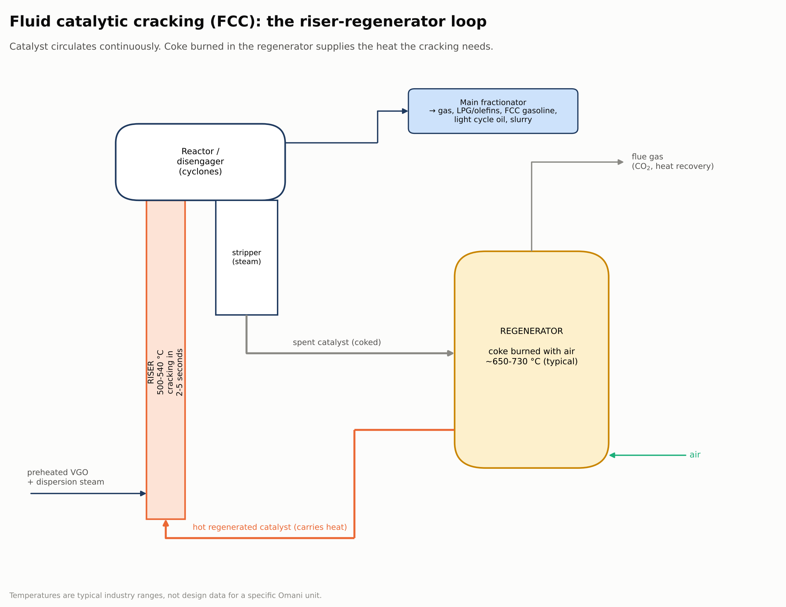

[← Previous: Vacuum distillation](03-vacuum-distillation.md) · **Stage 4: Conversion** · [Next: Treating →](05-treating.md)

# Stage 4: Conversion units: where the value is added

Distillation only separates what is already in the crude. Conversion units **change the molecules**: they crack heavy ones into lighter, more valuable ones, or reshape light ones into high-octane gasoline components.

## Unit by unit

| Unit | Feed (enters with) | Conditions (typical) | Catalyst | Product (leaves with) |
|---|---|---|---|---|
| **Fluid catalytic cracking (FCC)** | vacuum gas oil (Oman VGO: 1.49 wt% S) | riser 500-540 °C, a few seconds; regenerator about 650-730 °C | Y zeolite in a silica-alumina matrix, often with ZSM-5 | FCC gasoline, LPG and light olefins, light cycle oil, slurry |
| **Hydrocracking** | VGO (sometimes deasphalted oil) | 70-170 bar H₂, 350-450 °C | bifunctional: acid support + Ni, Mo, W or noble metal | low-sulfur diesel and jet fuel, naphtha |
| **Delayed coking** | vacuum residue (Oman VR: 3.04 wt% S) | furnace to about 480-510 °C, cracks over hours in a drum | none (thermal) | gas, coker naphtha, coker gas oil, petroleum coke |
| **Visbreaking** | vacuum residue | about 450-500 °C, mild | none (thermal) | lower-viscosity fuel oil, some light products |
| **Catalytic reforming** | hydrotreated heavy naphtha (S and N below about 0.5 ppm) | moderate pressure, about 480-530 °C | Pt-Re or Pt-Sn on chlorided alumina | high-octane reformate + hydrogen |
| **Alkylation** | C3-C4 olefins (from FCC / coker) + isobutane | low temperature, liquid acid | sulfuric or hydrofluoric acid | alkylate: high octane, very low sulfur |
| **Isomerisation** | light naphtha (C5-C6) | mild, with hydrogen | chlorided alumina or zeolite with Pt | isomerate: branched, higher-octane paraffins |

## How the FCC keeps itself running

1. Preheated VGO meets hot catalyst at the bottom of the **riser** and cracks within seconds.
2. Products and catalyst separate in the **reactor and cyclones**. Products go to the main fractionator.
3. Coke deposits on the catalyst and reduces its activity. The **spent catalyst** is steam-stripped and sent to the **regenerator**.
4. Coke is **burned with air**. The heat released goes back to the riser with the regenerated catalyst, so the unit is thermally self-sustaining.

## Hydrocracking versus FCC

| | FCC | Hydrocracker |
|---|---|---|
| Main product | gasoline + olefins | diesel + jet fuel |
| Hydrogen | none consumed | high consumption: hydrogen supply drives the economics |
| Product sulfur | needs downstream treating | very low sulfur straight from the unit |
| Pressure | low | very high |

## In Oman

- **Sohar** has an RFCC (residue FCC), a once-through hydrocracker, a delayed coker, solvent deasphalting, isomerisation and indirect alkylation. Its two-stage hydrocracker runs at about 160 bar and 400 °C and was built to make Euro V diesel.
- **Duqm** is built around a **hydrocracker** and a **delayed coker** (petroleum coke unit), aimed at middle distillates for export.
- **Mina Al Fahal:** no published unit list was found in the sources reviewed.

See [08 Oman refineries](08-oman-refineries.md).

*Operating ranges are typical industry values, not the design data of a specific Omani unit.*
