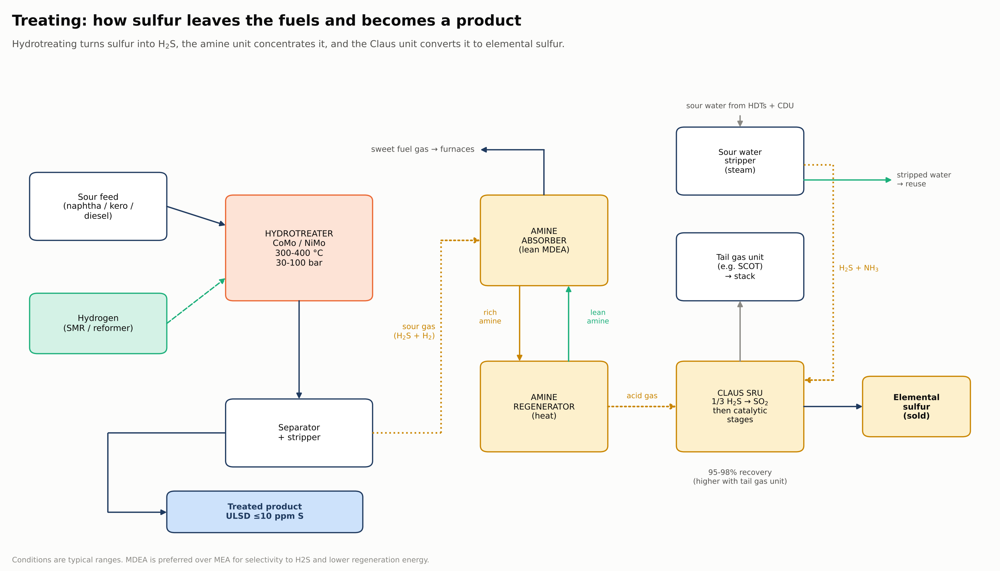

[← Previous: Conversion](04-conversion.md) · **Stage 5: Treating** · [Next: Hydrogen and utilities →](06-hydrogen-and-utilities.md)

# Stage 5: Treating and purification

Finished products must be cleaned of sulfur, nitrogen, metals, acids and gums. **Sulfur matters most**, because gasoline and diesel must reach about 10 ppm. The sulfur that is removed does not disappear: it travels as H₂S to the amine unit and leaves the refinery as solid or molten sulfur.

## Hydrotreating

- Feed is mixed with **hydrogen** and passed over a fixed bed of **CoMo or NiMo on alumina**.
- Typical conditions: **300-400 °C and 30-100 bar**.
- Organic sulfur becomes **H₂S**, nitrogen becomes **NH₃**, and metals and oxygen are removed.
- Key reaction: R-S-R' + 2 H₂ → RH + R'H + H₂S.
- Ultra-low-sulfur diesel needs deep hydrotreating at high hydrogen partial pressure. Hydrogen consumption and reactor design are the main design variables.

| Stream | Enters with (Oman straight-run) | Leaves with (typical target) |
|---|---|---|
| Heavy naphtha (reformer feed) | 0.04 wt% S | S and N below about 0.5 ppm (protects the Pt catalyst) |
| Kerosene / jet | 0.11 wt% S | meets Jet A-1: S ≤ 0.30 wt%, mercaptans controlled |
| Gas oil / diesel | 0.67 wt% S | ULSD: S ≤ 10 mg/kg |

## Amine sweetening

- H₂S is absorbed from refinery and fuel gas by an aqueous amine, usually **MDEA**, through a reversible reaction.
- **Rich amine** is heated in a regenerator, releasing a concentrated H₂S stream (acid gas) to sulfur recovery. **Lean amine** is recycled.
- MDEA is preferred over MEA for its selectivity to H₂S and lower regeneration energy.
- Leaves with: sweet fuel gas, low in H₂S (limit set by the environmental permit).

## Caustic treating and Merox

- Caustic (NaOH) removes H₂S and mercaptans from LPG and light liquids.
- In **Merox**, mercaptans are oxidised to disulfides with a catalyst and air.
- Spent caustic must be neutralised and treated before disposal.

## Sour water stripping

- Process water from hydrotreaters and the CDU carries dissolved H₂S and NH₃.
- A steam stripper removes them. The gas goes to sulfur recovery and the stripped water is reused (often as desalter wash water) or treated.

## Sulfur recovery (Claus)

- About **one third of the H₂S is burned** with air to SO₂ in the thermal stage.
- In the catalytic stages: **2 H₂S + SO₂ → 3 S + 2 H₂O**. Liquid sulfur condenses out.
- Two or three Claus stages recover about **95-98%** of the sulfur. A **tail gas unit** (such as SCOT) takes recovery higher to meet emission limits.
- Leaves with: elemental sulfur, typically ≥ 99.9 wt% pure, sold as a product.

*Conditions and targets are typical industry values.*
