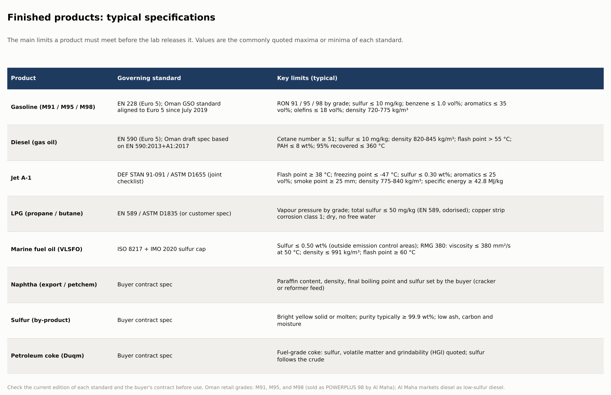

[← Previous: Hydrogen and utilities](06-hydrogen-and-utilities.md) · **Stage 7: Blending and products** · [Next: Refineries in Oman →](08-oman-refineries.md)

# Stage 7: Blending and finished products

Blending is the last stage. Streams from many units are combined in calculated ratios, additives are injected, and the laboratory releases each batch only when it meets its specification.

## What goes into each product

| Product | Blend components |
|---|---|
| Gasoline | reformate, FCC gasoline, alkylate, isomerate, butane (for vapour pressure) + additives |
| Jet A-1 | hydrotreated or Merox-treated kerosene, hydrocracker kerosene + additives (antioxidant, static dissipator) |
| Diesel | hydrotreated gas oil, hydrocracker diesel, treated light cycle oil + cetane and lubricity additives |
| LPG | propane and butane from the gas plant, Merox-treated |
| Fuel oil | residues cut back with lighter oils to meet viscosity |

## Product specifications (typical)

| Product | Governing standard | Key limits |
|---|---|---|
| **Gasoline (M91 / M95 / M98)** | EN 228 (Euro 5). Oman's gasoline standard (GSO-based) was aligned to Euro 5 from July 2019 | RON 91 / 95 / 98 by grade; sulfur ≤ 10 mg/kg; benzene ≤ 1.0 vol%; aromatics ≤ 35 vol%; olefins ≤ 18 vol%; density 720-775 kg/m³ |
| **Diesel** | EN 590 (Euro 5). Oman's diesel draft spec (2020) is based on EN 590:2013+A1:2017 | cetane number ≥ 51; sulfur ≤ 10 mg/kg; density 820-845 kg/m³; flash point > 55 °C; PAH ≤ 8 wt%; 95% recovered ≤ 360 °C |
| **Jet A-1** | DEF STAN 91-091 / ASTM D1655 | flash point ≥ 38 °C; freezing point ≤ -47 °C; sulfur ≤ 0.30 wt%; aromatics ≤ 25 vol%; smoke point ≥ 25 mm; density 775-840 kg/m³; specific energy ≥ 42.8 MJ/kg |
| **LPG** | EN 589 / ASTM D1835 or customer spec | vapour pressure by grade; total sulfur ≤ 50 mg/kg (EN 589); copper strip class 1 |
| **Marine fuel oil (VLSFO)** | ISO 8217 + IMO 2020 | sulfur ≤ 0.50 wt% outside emission control areas; RMG 380 viscosity ≤ 380 mm²/s at 50 °C; density ≤ 991 kg/m³; flash point ≥ 60 °C |
| **Naphtha** | buyer contract | paraffin content, density, end point and sulfur set by the buyer |
| **Sulfur** | buyer contract | purity typically ≥ 99.9 wt%; low ash, carbon and moisture |
| **Petroleum coke** | buyer contract | fuel grade: sulfur, volatile matter and grindability quoted |

## Oman's retail fuels

| Grade | Notes |
|---|---|
| **M91** | standard grade for most petrol cars; introduced in November 2016 |
| **M95** | recommended for modern light-vehicle engines |
| **M98** | premium grade launched by Oman Oil in 2018; sold by Al Maha as POWERPLUS 98 |
| **Diesel** | marketed as low-sulfur diesel |

## Blending in practice

- **Octane** blends roughly by volume, but not perfectly linearly, so refiners use blending indices.
- **Sulfur** blends by mass, so one high-sulfur component can push the whole batch off spec.
- **Vapour pressure** is adjusted with butane, within the seasonal limit.
- Every batch is sampled, tested and certified before release to tanks, trucks, the pipeline or a ship.

*Spec values are the commonly quoted limits of each standard. Check the current edition and the buyer's contract before use.*
