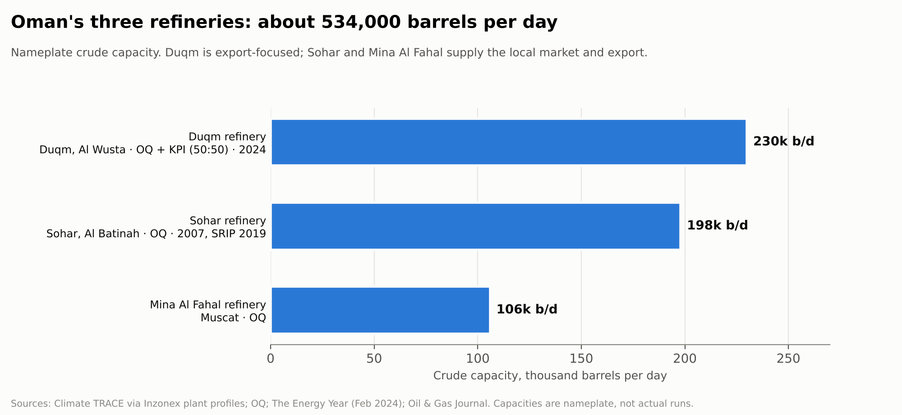
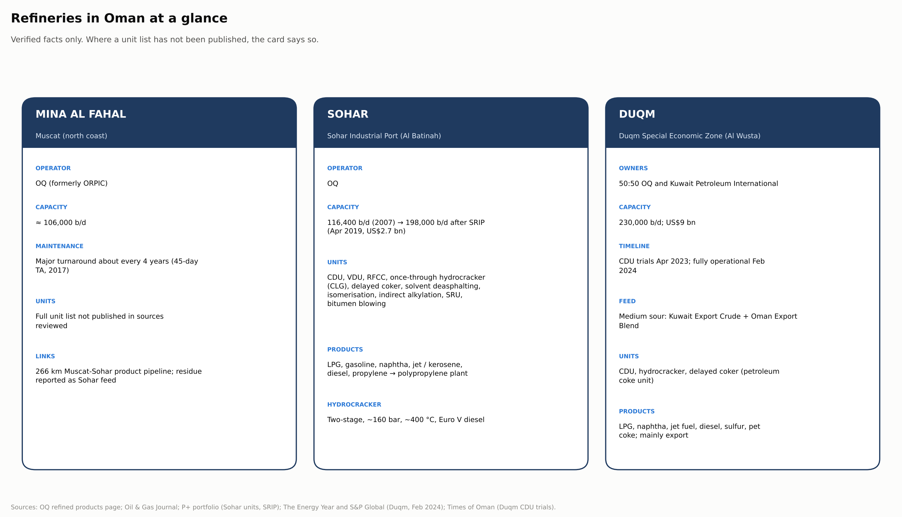

[← Previous: Blending and products](07-blending-and-products.md) · **Refineries in Oman** · [Next: Sources and glossary →](09-sources-and-glossary.md)

# Refineries in Oman

Oman has three refineries with a combined nameplate capacity of about **534,000 barrels per day**. OQ operates Mina Al Fahal and Sohar, and co-owns Duqm with Kuwait Petroleum International.

## Comparison

| | Mina Al Fahal | Sohar | Duqm |
|---|---|---|---|
| **Location** | Muscat | Sohar Industrial Port, Al Batinah | Duqm Special Economic Zone, Al Wusta (about 600 km south of Muscat) |
| **Owner / operator** | OQ (formerly ORPIC) | OQ | Duqm Refinery and Petrochemical Industries: 50:50 OQ and Kuwait Petroleum International |
| **Capacity** | about 106,000 b/d | 198,000 b/d (116,400 b/d at start-up, plus 82,000 b/d from SRIP) | 230,000 b/d |
| **Key dates** | 45-day turnaround in Oct-Nov 2017; major turnarounds about every 4 years | full production 2007; SRIP completed April 2019 (US$2.7 bn) | CDU trials April 2023; fully operational February 2024 (US$9 bn) |
| **Crude** | not stated in sources reviewed | heavier Omani crude (SRIP); Mina Al Fahal residue reported as a feed | medium sour: Kuwait Export Crude and Oman Export Blend; heavy sour planned |
| **Main units** | not published in sources reviewed | CDU, VDU, RFCC, once-through hydrocracker, delayed coker, solvent deasphalting, isomerisation, indirect alkylation, SRU, bitumen blowing | CDU, hydrocracker, delayed coker (petroleum coke unit) |
| **Products** | supplies the local market | LPG, gasoline, naphtha, jet / kerosene, diesel; propylene to the polypropylene plant | LPG, naphtha, jet fuel, diesel, sulfur, petroleum coke |
| **Market** | domestic + export | domestic + export | mainly export (Europe a stated target) |

## Mina Al Fahal

- Near Muscat, operated by OQ, about 106,000 b/d (Climate TRACE; Oil & Gas Journal).
- Its 2017 turnaround lasted 45 days (3 October to 16 November) and covered inspection, debottlenecking, revamps and catalyst regeneration. OQ says such turnarounds happen about every four years.
- A 266 km pipeline links Mina Al Fahal and Sohar. Mina Al Fahal residue is reported as a feed to Sohar, and its fuel oils as desulfurised there (secondary source).
- **Gap:** the process-unit list, licensors and product slate were not found in public sources.

## Sohar

- Started full production in August 2007 at **116,400 b/d**, with a 75,260 b/d RFCC unit.
- The **Sohar Refinery Improvement Project (SRIP)** added an 82,000 b/d crude unit, raising capacity to **198,000 b/d**. It was completed in April 2019 at about US$2.7 bn.
- According to OQ, the refinery's crude and vacuum distillation, **delayed coker**, **hydrocracker** and **bitumen blowing** units let it process heavier Omani crude. The hydrocracker uses Chevron Lummus Global technology and is a two-stage unit at about 160 bar and 400 °C, built for Euro V distillates.
- Other units reported in project records: solvent deasphalting (UOP technology), isomerisation, indirect alkylation, sulfur recovery (Black & Veatch licence), amine regeneration, sour water stripping and a hydrogen plant.
- Sohar supplies propylene to OQ's polypropylene plant, which links refining to petrochemicals.

## Duqm

- A **50:50 joint venture** of OQ and Kuwait Petroleum International, costing about **US$9 bn**.
- **230,000 b/d.** Trial operations began in April 2023 and the refinery became fully operational in February 2024.
- Designed to **upgrade the bottom of the barrel** into middle distillates, with a hydrocracker and a petroleum coke unit.
- Diesel is the largest product. The refinery is export-oriented, and the operator has considered upgrading naphtha for gasoline.

## Gaps to fill

These were not found in public sources and would be worth asking about during training:

- the Mina Al Fahal unit list and capacities
- Duqm's individual unit capacities and product yields
- each refinery's actual crude slate and product specifications

*Facts on this page come from the sources in [09 Sources](09-sources-and-glossary.md). Capacities are nameplate, not actual runs.*
