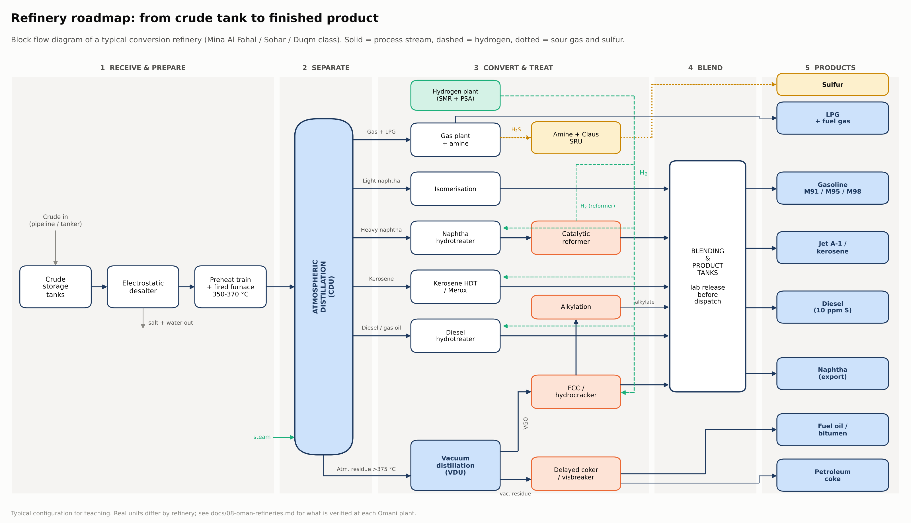
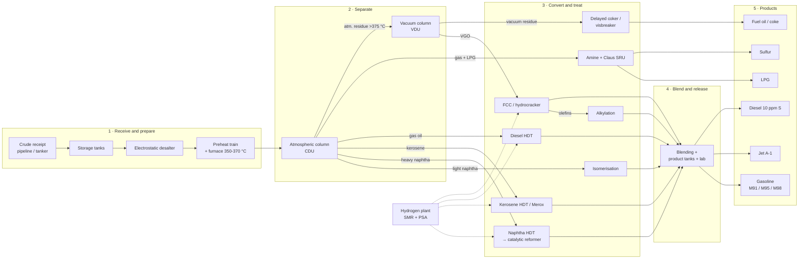
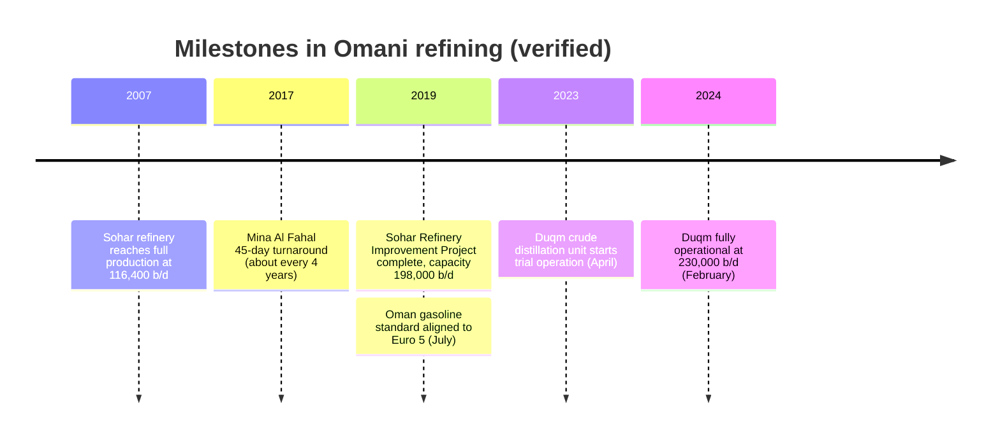

# Oman Refinery Roadmap: from crude oil to finished product

A step-by-step map of how a refinery turns crude oil into fuels. It follows the oil through each station in order, gives the specification of the material **entering** and **leaving** every stage, and takes a closer look at Oman's three refineries: Mina Al Fahal, Sohar and Duqm.

Training notes by **Mohamed Al-Hashami**, Chemical and Process Engineering (SQU).

## Interactive website

`index.html` is a zoomable presentation canvas, like a Prezi board: a hub in the centre with eight branches arranged as a process loop around it (Refinery 101, the six process stages, refining economics with live calculators, and a map of Oman's refineries). Click a panel or press `1-8` and the camera flies to it; `→` / `Space` step forward, `←` back, `0` or `Esc` return to the overview, `L` process line, `F` figures, `S` sources. On phones it switches to a scrolling layout.

To publish it with **GitHub Pages**: open the repository's **Settings → Pages**, set **Source** to *Deploy from a branch*, pick `main` and `/ (root)`, and save. After about a minute the site is live at `https://<your-username>.github.io/oman-refinery-roadmap/`.

---

## The roadmap

| # | Stage | What happens | Material in → out | Page |
|---|-------|--------------|-------------------|------|
| 0 | Crude feed | Crude is received, sampled and tested against the purchase contract | Oman crude: 31.3 °API, 1.41 wt% S, 59 mg/kg salt | [00 Crude feed](00-crude-feed.md) |
| 1 | Desalting | Wash water + demulsifier + electric field remove salt and water | ~18 ptb salt → about 1 ptb | [01 Desalting](01-desalting.md) |
| 2 | Atmospheric distillation | Heated crude splits by boiling range | crude → gas, naphtha, kerosene, gas oil, residue | [02 CDU](02-atmospheric-distillation.md) |
| 3 | Vacuum distillation | Residue distilled under vacuum to avoid cracking | atm. residue → VGO + vacuum residue | [03 VDU](03-vacuum-distillation.md) |
| 4 | Conversion | Heavy molecules cracked or reshaped into valuable ones | VGO / residue / naphtha → gasoline, diesel, jet, coke | [04 Conversion](04-conversion.md) |
| 5 | Treating | Sulfur, nitrogen and metals removed; sulfur recovered | 0.02-1.5 wt% S cuts → 10 ppm S fuels + elemental sulfur | [05 Treating](05-treating.md) |
| 6 | Hydrogen and utilities | Hydrogen, steam, cooling water, flare and effluent treatment | natural gas → H₂ ≥ 99.9 vol% (typical) | [06 Hydrogen and utilities](06-hydrogen-and-utilities.md) |
| 7 | Blending and products | Streams blended to spec and released by the lab | components → M91/M95/M98, Jet A-1, diesel, LPG, fuel oil | [07 Products](07-blending-and-products.md) |
| 8 | Refineries in Oman | Mina Al Fahal, Sohar and Duqm compared | about 534,000 b/d in total | [08 Oman refineries](08-oman-refineries.md) |

---

## Oman at a glance

---

## Figures (ready for reports)

| Figure | File |
|--------|------|
| Refinery block flow diagram | [fig01_refinery_roadmap.png](fig01_refinery_roadmap.png) |
| Atmospheric column with Oman crude cut yields | [fig02_atmospheric_column.png](fig02_atmospheric_column.png) |
| FCC riser-regenerator loop | [fig03_fcc_loop.png](fig03_fcc_loop.png) |
| Sulfur path: hydrotreater → amine → Claus | [fig04_sulfur_loop.png](fig04_sulfur_loop.png) |
| One barrel of Oman crude by boiling range | [fig05_oman_crude_barrel.png](fig05_oman_crude_barrel.png) |
| Raw material: Oman crude feed specification | [fig06_crude_feed_spec.png](fig06_crude_feed_spec.png) |
| Finished product specifications | [fig07_product_specs.png](fig07_product_specs.png) |
| Oman refinery capacity | [fig08_oman_refinery_capacity.png](fig08_oman_refinery_capacity.png) |
| Oman refinery profiles | [fig09_oman_refineries.png](fig09_oman_refineries.png) |

All figures are 200 dpi PNG and can be inserted directly into Word or PowerPoint.

---

## Learning progress

- [x] Week 1: chemical engineering fundamentals (energy balance, mass balance, Bernoulli), SAF feasibility, RCA, SOPs
- [x] Week 2: refinery processing route, upstream facilities (Petrogas Rima, CCED), production chemicals
- [x] Week 2: raw material and product specifications, refineries in Oman (this repository)
- [ ] Next: mass balance of a CDU using the Oman assay yields
- [ ] Next: product blending calculation (octane and sulfur by volume)
- [ ] Next: hydrogen balance for a diesel hydrotreater

---

## Repository layout

All files sit at the top level: `index.html` (website), `README.md`, the stage pages `00-…` to `09-….md`, and the figures `fig01_…` to `fig09_….png`.

## How to read the numbers

- **Verified:** taken from a named public source (listed in [09 Sources](09-sources-and-glossary.md)). Oman crude values come from a TotalEnergies assay sheet; refinery facts come from OQ, Oil & Gas Journal, The Energy Year, S&P Global and Climate TRACE.
- **Typical:** standard industry ranges (temperatures, pressures, spec limits). They are not the design data of any specific Omani unit. Always check the current edition of a standard and the operator's own data before using a number in a calculation or decision.
